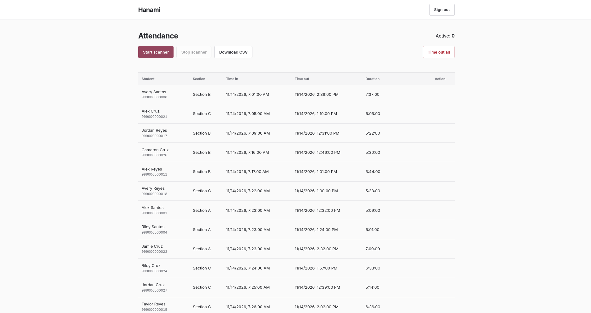
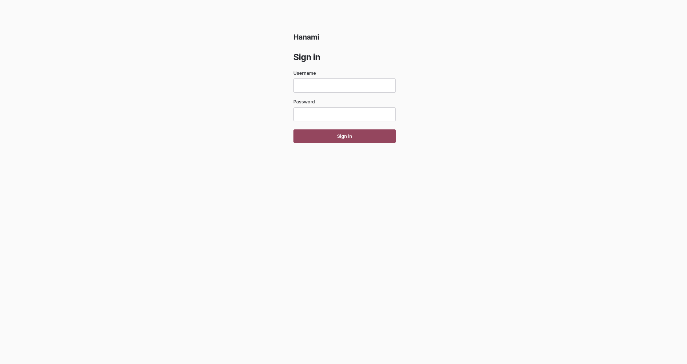
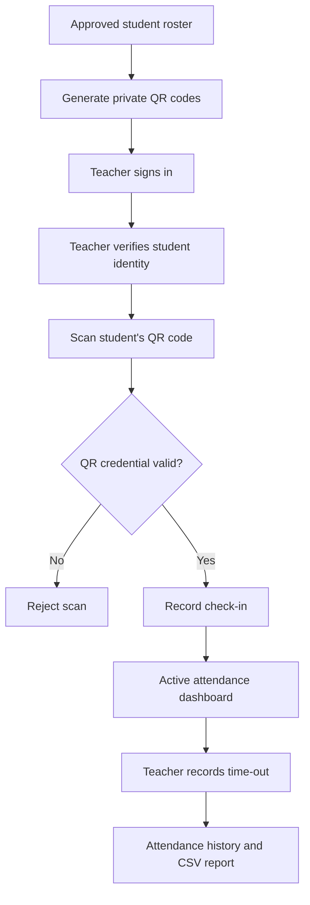

# Attendance System by Khaiyen

[](https://github.com/Khaiyen-Salaria/Attendance-System-by-Khaiyen/releases)
[](https://flask.palletsprojects.com/)
[](LICENSE)

A teacher-operated web application for recording student attendance with QR codes. Teachers can verify student identity, scan QR codes to record check-ins, manage time-outs, monitor active attendance, and export attendance history as CSV. It runs with SQLite by default, with optional PostgreSQL support.

> **Quick overview:** Approved students receive private QR codes. A teacher signs in, verifies the student, and scans the code. The server validates the QR credential and records attendance.

## App preview

The screenshots below show the teacher sign-in screen and the attendance dashboard.

<p align="center">
  
</p>
<p align="center"><em>Attendance dashboard</em></p>

<p align="center">
  
</p>
<p align="center"><em>Teacher sign-in</em></p>

## Features

- **Teacher-only access:** Accounts are created by an operator; there is no public teacher sign-up or student attendance endpoint.
- **QR-based check-in:** Each student receives a private QR credential that is verified by the server against the approved roster.
- **Attendance and time-out tracking:** View active attendance, record individual time-outs, or close all active records.
- **Flexible roster setup:** Import an approved CSV roster or connect Google Forms and Google Sheets for registration requests and teacher approval.
- **Automatic QR generation:** Generate QR images for enrolled students and rotate a lost or copied credential.
- **Attendance reports:** Review attendance history and download CSV files containing check-in, check-out, and duration details.
- **Audit and security controls:** Includes CSRF protection, login throttling, protected session cookies, session invalidation after password resets, safe student-name rendering, CSV formula protection, and database enforcement of one active record per student.
- **Database options:** SQLite is used by default; PostgreSQL is available for deployments that need a separate database.

## How it works



For optional student registration, the separate onboarding flow is:

```text
Google Form → Google Sheet → Pending registration → Teacher approval → Active roster → QR code
```

A form submission is only a registration request. It does not record attendance or create a teacher account.

## Technology stack

| Area | Technology |
|---|---|
| Backend | Python 3.12+, Flask 3.1.3 |
| Frontend | HTML, CSS, JavaScript |
| Database | SQLite by default; optional PostgreSQL |
| QR codes | `qrcode` with Pillow; local QR decoder in the browser |
| Production server | Gunicorn |
| Optional integrations | Google Forms/Sheets CSV export and SMTP email delivery |

The browser QR decoder is included in the repository, so Node.js is not required to run the application.

## Requirements

- Python **3.12 or later** and pip.
- A modern web browser.
- A camera if you want to scan QR codes.
- Internet access to install Python dependencies.
- An operator-approved student roster. Each student record needs a full name, section, 12-digit LRN, and email address.

PostgreSQL, Google Sheets, SMTP, Node.js, and Chromium are optional. The default SQLite installation does not require them. Camera scanning requires browser camera permission and a secure context: use localhost for local development and HTTPS for remote access.

## Installation and quick start

The steps below create a local SQLite installation. Run commands from the repository root (the folder containing `server.py` and `requirements.lock`).

### 1. Clone the repository

```bash
git clone https://github.com/Khaiyen-Salaria/Attendance-System-by-Khaiyen.git
cd Attendance-System-by-Khaiyen
```

### 2. Create a virtual environment

**Linux / macOS**

```bash
python3 -m venv .venv
source .venv/bin/activate
```

**Windows PowerShell**

```powershell
py -3 -m venv .venv
.\.venv\Scripts\Activate.ps1
```

### 3. Install dependencies

```bash
python -m pip install -r requirements.lock
python -m pip check
```

The lock file pins the application dependencies. No npm install is needed for the normal application runtime.

### 4. Initialize the database

```bash
python -m flask --app server init-db
```

Without `DATABASE_URL`, the application creates its SQLite database and private runtime files under `.instance/`.

### 5. Create a teacher account

```bash
python -m flask --app server create-teacher your_username
```

Replace `your_username` with a username containing 3–100 letters, digits, periods, underscores, or hyphens. The command securely prompts for a password between 12 and 256 characters. There is no default account. Do not put passwords in source code or command-line arguments.

### 6. Import an approved student roster

Create a UTF-8 CSV file named `roster.csv` with these exact headers:

```csv
full_name,section,lrn,email
Example Student,Section A,123456789012,student@example.test
```

Replace the sample row with approved student information. Keep LRNs as text so leading zeros are preserved. Each LRN must contain exactly 12 digits, and each student must have a valid email address.

Import the roster:

```bash
python fetch_students.py roster.csv
```

The importer validates the complete file before inserting records. Existing LRNs are skipped; this command does not update previously imported student details.

### 7. Generate QR codes

```bash
python qr_generator.py
```

QR images are saved in `.instance/qrcodes/`, named by LRN. Distribute each image privately to the corresponding student. QR generation does not send email automatically.

### 8. Start the application

**Linux / macOS**

```bash
ATTENDANCE_LOCAL_HTTP=1 bash scripts/start.sh
```

**Windows PowerShell**

```powershell
$env:ATTENDANCE_LOCAL_HTTP = "1"
python server.py
```

Keep the terminal running and open [http://127.0.0.1:5000](http://127.0.0.1:5000) in a browser on the same machine. Sign in with the teacher account created in step 5.

`ATTENDANCE_LOCAL_HTTP=1` is for local development only. Production deployments must use HTTPS.

### 9. Check the installation

With the application running, open a second terminal in the project folder and run:

```bash
python scripts/smoke.py
```

Then use **Start scanner** in the dashboard and allow camera access. Verify each student's identity before scanning their QR code.

## Google Forms and Google Sheets registration (optional)

The repository includes a Google Apps Script template at [`templates/google-forms/create-form.gs`](templates/google-forms/create-form.gs) and an example response file at [`templates/google-forms/responses-example.csv`](templates/google-forms/responses-example.csv).

1. Open Google Apps Script, create a standalone project, and paste in `create-form.gs`.
2. Update the `sections` array to match your school's sections. Run `createAttendanceRegistrationForm()` and authorize the script. The execution log provides the form and spreadsheet links.
3. Review the form before sharing it. Enable email collection (use verified collection where available), limit users to one response, disable response editing, and keep response-summary sharing disabled.
4. Submit a test response. In the linked response sheet, add a teacher-controlled `approved` column with TRUE/FALSE checkboxes. Do not add `approved` as a student form question.
5. Teachers should verify each student's name, section, LRN, and collected email against the official school roster before approving a row.
6. Configure the spreadsheet's CSV export URL as `STUDENT_SHEET_URL`, then import the form responses:

**Linux / macOS**

```bash
export STUDENT_SHEET_URL='https://docs.google.com/spreadsheets/d/SPREADSHEET_ID/export?format=csv&gid=TAB_GID'
python fetch_students.py --google-forms
```

**Windows PowerShell**

```powershell
$env:STUDENT_SHEET_URL = 'https://docs.google.com/spreadsheets/d/SPREADSHEET_ID/export?format=csv&gid=TAB_GID'
python fetch_students.py --google-forms
```

Replace `SPREADSHEET_ID` and `TAB_GID` with the values for the correct sheet and tab. The export must be downloadable as CSV by the application. The `--google-forms` flag is required so the importer can read the Forms response headers and approval column.

When `STUDENT_SHEET_URL` is configured, the standard startup commands start a polling worker that checks for updates every 30 seconds by default. The interval can be changed with `STUDENT_SYNC_INTERVAL` (10–3600 seconds). New requests remain pending until a teacher approves them; approved students are added to the roster and receive QR images. This is polling, not an instant form-submission webhook.

> **Student data privacy:** Anyone who has access to a Viewer-accessible spreadsheet link can read and download the student data in that spreadsheet, including names, LRNs, and email addresses. Do not post the link publicly. A safer option is to keep raw form responses private and share a separate sheet containing only approved records. Follow your school's data-protection and sharing policies; use local CSV import if public-link access is not permitted.

## Daily use

1. Start the application and sign in as a teacher.
2. Select **Start scanner** and allow camera access.
3. Verify the student's identity, then scan the student's QR code.
4. Review the student's attendance record in the dashboard.
5. Select **Time out** beside a student, or **Time out all** to close all active records.
6. Select **Stop scanner** when scanning is complete, then use **Download CSV** to export the records.
7. Log out when finished, especially on a shared device.

Stopping the camera does not time students out. Use the time-out controls to close active attendance records. Attendance is stored in the database and remains available after application restarts.

## Account and QR maintenance

Create another teacher:

```bash
python -m flask --app server create-teacher another_username
```

Reset a teacher's password (existing sessions for that teacher are invalidated):

```bash
python -m flask --app server reset-teacher-password your_username
```

Revoke and replace a student's lost or copied QR credential:

```bash
python qr_generator.py --rotate 123456789012
```

Replace the example LRN with the student's actual LRN. Distribute the new QR image privately. Generating QR images without `--rotate` does not revoke an existing credential.

## Configuration

Configuration is supplied through the shell or your deployment's secret manager. The example file is [`.env.example`](.env.example), but **the application does not automatically load `.env` files**. Do not commit real credentials.

| Variable | Purpose |
|---|---|
| `ATTENDANCE_INSTANCE` | Private persistent data directory; defaults to `.instance/`. |
| `DATABASE_URL` | PostgreSQL connection URL; omit to use SQLite. |
| `ATTENDANCE_LOCAL_HTTP` | Set to `1` only for local HTTP development. Leave unset in production. |
| `ATTENDANCE_TRUSTED_HOSTS` | Comma-separated list of exact hostnames accepted by the application. |
| `ATTENDANCE_SESSION_KEY` | Optional private session-key override; at least 32 random characters. |
| `ATTENDANCE_QR_KEY` | Optional private QR-key override; URL-safe base64 encoding of 32 random bytes. |
| `STUDENT_SHEET_URL` | Viewer-accessible Google Sheets CSV export URL; enables roster sync with the standard startup commands. |
| `STUDENT_SYNC_INTERVAL` | Roster polling interval in seconds; defaults to `30` and accepts `10–3600`. |
| `SMTP_HOST`, `SMTP_USER`, `SMTP_PASSWORD` | Optional SMTP settings for explicit QR email delivery. |
| `SMTP_PORT` | SMTP TLS port; defaults to `465`. |
| `ATTENDANCE_WORKERS` | Worker count used by `scripts/start.sh`; defaults to `2`. |
| `ATTENDANCE_BIND` | Bind address used by `scripts/start.sh`; defaults to `127.0.0.1:5000`. |

### Optional PostgreSQL setup

Create an empty PostgreSQL database and a dedicated application role, configure `DATABASE_URL` securely, then initialize the schema:

```bash
python -m flask --app server init-db
```

Remote PostgreSQL connections require certificate-verified TLS (`sslmode=verify-full`) and a trusted root certificate. Keep database credentials and access private.

### Migrating an existing PostgreSQL installation

For an installation that still uses the original PostgreSQL schema, stop the old application and make a verified database backup before migrating. Configure `DATABASE_URL` for the existing database, then run the migration with the timezone used by the original machine (the example below uses Manila time):

```bash
python -m flask --app server migrate-legacy --timezone Asia/Manila --yes
python qr_generator.py
```

The migration preserves teachers, student roster records, and attendance history while replacing legacy QR credentials. Distribute the newly generated QR images. Before returning the system to service, review and replace any credentials or private keys that may have been exposed in an older installation. Do not run a migration against a live database without a verified backup.

### Optional QR email delivery

Set `SMTP_HOST`, `SMTP_USER`, and `SMTP_PASSWORD` securely. `SMTP_PORT` defaults to `465`. Then run this command explicitly:

```bash
python app.py --send-email
```

Running `python app.py` without `--send-email` only generates QR images. The application does not automatically email the entire roster during normal startup or roster sync. Avoid repeating the email command unless you intend to send the QR images again.

## Security and privacy notes

- Use HTTPS in production and keep `ATTENDANCE_LOCAL_HTTP` unset.
- Keep `.instance/`, database files, private keys, roster CSVs, and generated QR images out of public version control.
- Back up `.instance/` for SQLite deployments. For PostgreSQL, back up the database and private application keys.
- Keep the session and QR keys persistent and private. Losing the QR key invalidates existing QR codes; replacing the session key signs teachers out.
- A QR code can be photographed or shared. A teacher must verify the student's identity before accepting a scan.
- Teachers share access to the roster and attendance history; the application does not currently provide per-class permission partitions.
- Do not expose student information through a publicly shared Google Sheet. Follow applicable school policies and data-protection requirements.

For production, deploy behind an HTTPS reverse proxy on a supported Linux server. Keep Gunicorn bound to loopback, restrict database access, configure exact trusted hostnames, and apply appropriate proxy-level security and rate limits.

## Troubleshooting

| Problem | What to check |
|---|---|
| Camera is unavailable | Open the app through localhost for local use or HTTPS in a remote deployment, allow camera access, and check whether another application is using the camera. |
| Login fails | Confirm a teacher account exists. There is no default account; use the password-reset command if necessary. |
| Too many login attempts | Wait for the login rate-limit window to expire before trying again. |
| QR code is invalid or revoked | Generate and distribute the student's current QR image. Legacy QR credentials are intentionally rejected after migration. |
| Student is already checked in | Use the Time out control to close the active attendance record before scanning again. |
| Google Forms import is rejected | Use `--google-forms`, confirm the collected `Email Address` column, and include a teacher-managed `approved` column with TRUE/FALSE values. |
| Roster import fails | Check the exact CSV headers, 12-digit LRNs, names, sections, and email addresses. |

## Tests

Run the core test suite:

```bash
python -m unittest discover -s tests -v
python -m pip check
```

Optional browser-script checks (requires Node.js):

```bash
node --check static/js/scanner.js
node --check static/js/qr-camera.js
```

Additional PostgreSQL and Chromium integration-test scripts are included under `tests/`. The automated browser tests use a fake camera; physical mobile-camera behavior and a production HTTPS proxy should be tested in your own deployment environment.

## Project structure

```text
Attendance-System-by-Khaiyen/
├── scripts/                 # Setup, startup, smoke-test, and helper scripts
├── static/                  # Browser assets, styles, scripts, and vendored libraries
├── templates/               # Flask HTML templates
│   └── google-forms/         # Apps Script form template and sample CSV
├── tests/                   # Unit and integration tests
├── .env.example             # Configuration reference (not auto-loaded)
├── app.py                   # QR generation and optional email delivery
├── config.py                # Application configuration
├── db.py                    # Database access and migrations
├── email_sender.py          # SMTP email delivery
├── encryption.py            # Key and encryption helpers
├── fetch_students.py        # CSV and Google Forms roster import
├── qr_generator.py          # QR image generation and rotation
├── qr_tokens.py             # QR credential creation and verification
├── requirements.lock       # Pinned Python dependencies
├── requirements.txt        # Application dependencies
├── server.py                # Flask application and CLI commands
└── sync_worker.py           # Google Sheets roster synchronization
```

## Contributing

Bug reports, suggestions, and pull requests are welcome. Before proposing a change, open an issue describing the problem or improvement. For pull requests, include a clear summary and test the affected workflows where possible. Do not include real student records, credentials, private keys, or QR images in issues or commits.

## License

This project is licensed under the **MIT License**. Copyright (c) 2026 **Khaiyen Salaria**. See the [`LICENSE`](LICENSE) file for the complete license terms.

## Project

- **Repository:** [Khaiyen-Salaria/Attendance-System-by-Khaiyen](https://github.com/Khaiyen-Salaria/Attendance-System-by-Khaiyen)
- **Releases:** [Attendance_System_by_Khaiyen releases](https://github.com/Khaiyen-Salaria/Attendance-System-by-Khaiyen/releases)
- **Status:** v1.0.0 Released
